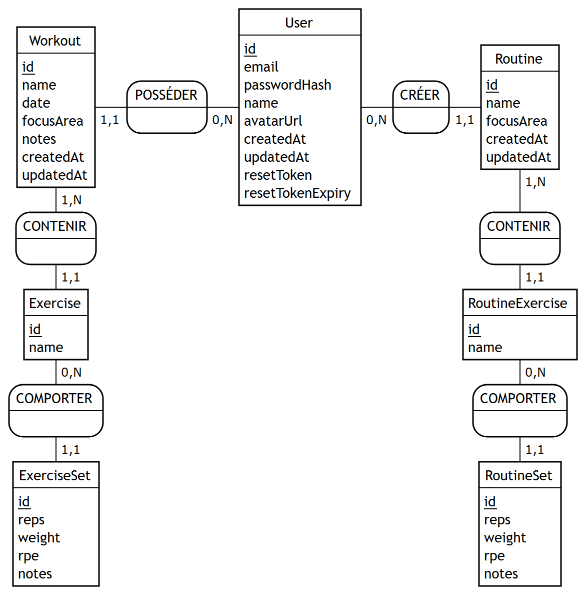

# Conception de la base de données

Documents Merise de la base PostgreSQL d'AppMuscu.

**Source de vérité** : `server/prisma/schema.prisma` et les migrations de `server/prisma/migrations/`. Si l'un de ces fichiers change, ces documents doivent être mis à jour.

| Fichier | Contenu |
|---|---|
| [mcd.mmd](mcd.mmd) | MCD : script Mocodo (source) |
| [mcd.svg](mcd.svg) / [mcd.png](mcd.png) | MCD : export image |
| [mld.md](mld.md) | MLD : schéma relationnel, clés primaires soulignées, clés étrangères préfixées par `#` |
| [mpd.sql](mpd.sql) | MPD : script SQL PostgreSQL de l'état final (généré par Prisma) |
| [mpd.md](mpd.md) | MPD : types, contraintes nommées, `ON DELETE CASCADE` |
| [dictionnaire-donnees.md](dictionnaire-donnees.md) | Dictionnaire de données, table par table |
| [cardinalites.md](cardinalites.md) | Justification des cardinalités, une phrase par association |



## Régénérer les fichiers

### MCD (Mocodo 4.3.3)

Mocodo n'ouvre que les fichiers `.mcd` : il faut copier le script avant de le compiler.

```bash
pip install mocodo
cp docs/conception/mcd.mmd /tmp/mcd.mcd
mocodo --input /tmp/mcd.mcd
```

La commande produit `mcd.svg`. Mocodo ne sait produire un PNG (`--svg_to png`) que si CairoSVG fonctionne, ce qui n'est pas le cas par défaut sous Windows. Le `mcd.png` de ce dossier est une capture du SVG faite avec un navigateur headless (Edge), à l'échelle ×2.

On peut aussi coller le contenu de `mcd.mmd` sur https://www.mocodo.net.

### MPD

```bash
cd server
npx prisma migrate diff --from-empty --to-schema-datamodel prisma/schema.prisma --script
```

La commande n'a pas besoin de connexion à la base. Sa sortie (sans l'en-tête de commentaires) correspond à `mpd.sql`.
